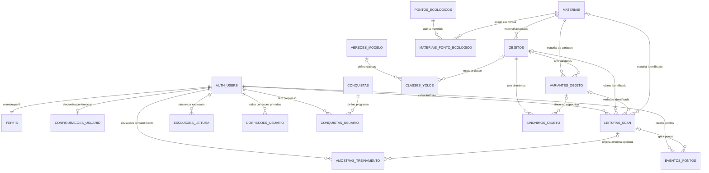

# Estrutura do banco do EcoScan AI

Este é o desenho que a migração consolidada instala. Tabelas, colunas, funções, visões e políticas do aplicativo usam nomes em português. `auth.users` e `storage.*` são componentes internos obrigatórios do Supabase; os IDs de buckets e rótulos técnicos do YOLO também permanecem estáveis para não quebrar o app.

## Diagrama

`HISTORICO_LEITURAS_USUARIO` e `ESTATISTICAS_USUARIO` são visões calculadas, não tabelas editáveis. O histórico oculta análises removidas por uma exclusão sincronizada; as estatísticas somam leituras, confirmações, categorias e pontos.

## Tabelas e responsabilidades

| Tabela | O que guarda e por que existe |
| --- | --- |
| `auth.users` | Conta, e-mail e autenticação administrados pelo Supabase. O app nunca cria linhas diretamente. |
| `perfis` | Um perfil por conta. Um gatilho copia nome e e-mail do Auth e mantém o cadastro atualizado. |
| `configuracoes_usuario` | Tema, sons, avisos, exploração do mapa e caminho da foto de perfil. Preferências e a foto sincronizam com a conta. |
| `materiais` | Cadastro único dos materiais e orientações de descarte, ligado ao catálogo, às leituras e aos pontos de coleta. |
| `objetos` | Catálogo de objetos, rótulo de detecção, ambiguidade e orientação padrão. Uma garrafa genérica ambígua não é classificada sem uma variante segura. |
| `variantes_objeto` | Alternativas materiais de um objeto ambíguo, por exemplo garrafa de vidro ou de plástico. |
| `sinonimos_objeto` | Rótulos do detector e sinônimos usados para encontrar o objeto ou a variante. Os rótulos do modelo continuam iguais aos nomes técnicos YOLO. |
| `pontos_ecologicos` | Localização, endereço, tipo e dados da fonte GeoSampa. O app baixa esta lista e mantém um cache local. |
| `materiais_ponto_ecologico` | Relação muitos-para-muitos: cada linha indica um material aceito por um ponto. |
| `leituras_scan` | Histórico sincronizado da conta, com cópia do resultado visto na hora, confiança, confirmação e vínculos opcionais com objeto, variante e material. Latitude e longitude não são sincronizadas. |
| `exclusoes_leitura` | Registro de exclusões para que uma leitura apagada em um aparelho não reapareça em outro. |
| `amostras_treinamento` | Correções e fotos enviadas somente após consentimento. Começam pendentes e podem ser ligadas a uma leitura quando houver esse ID. |
| `correcoes_usuario` | Cópia privada da correção e da foto na conta, restaurada após reinstalar. Só é transferida para `amostras_treinamento` quando a pessoa autoriza o envio. |
| `versoes_modelo` | Arquivos YOLO publicados, hash e tamanho para validar downloads. A troca automática de modelo continua desligada até uma publicação revisada. |
| `classes_yoloe` | Índice, rótulo e prompt de cada classe, com ligação opcional à versão publicada e ao objeto. |
| `eventos_pontos` | Extrato calculado pelo banco. O app não recebe permissão para criar ou editar pontos diretamente. |
| `conquistas` | Regras e metas disponíveis para desbloqueio. |
| `conquistas_usuario` | Progresso e data de desbloqueio de cada conquista por conta. |

O Storage usa três buckets privados: `ecoscan-account-data` guarda fotos de perfil, leituras e correções privadas; `ecoscan-training` guarda imagens enviadas com consentimento; `ecoscan-models` guarda versões de modelo. Os nomes são IDs técnicos usados pelo app e não devem ser traduzidos ou renomeados.

## Como os dados se conectam

- **Conta → perfil e preferências:** o Auth fornece `usuario_id`; políticas RLS limitam linhas à pessoa autenticada. O perfil é criado pelo gatilho. Preferências continuam disponíveis localmente se a rede falhar.
- **Objeto → variante → material:** objetos simples podem apontar para um material padrão. Um objeto ambíguo só retorna um resultado quando o detector/sinônimo encontra uma variante específica.
- **Ponto → materiais aceitos:** a tabela de ligação substitui a lista solta de IDs. Ela permite procurar pontos por material e conferir o que cada ponto recebe.
- **Conta → leituras → histórico:** cada leitura tem chave composta por conta e ID local. Exclusões sincronizadas são mantidas separadamente para proteger aparelhos que ficaram offline.
- **Leitura → pontos e conquistas:** gatilhos calculam eventos a partir do histórico, incluindo bônus de primeira leitura, material reciclável e nova categoria. Repetições não criam bônus duplicados. As metas e desbloqueios são atualizados no banco.
- **Correção → conta → amostra:** foto e dados da correção são salvos na área privada da conta. O envio ao bucket de treinamento e à tabela `amostras_treinamento` exige consentimento; aprovação/rejeição continua exigindo revisão administrativa.
- **Versão → classes YOLO:** a versão publicada pode definir seu índice de classes. O app só baixa modelos se a opção correspondente estiver ativada e o hash/tamanho forem válidos.

## Segurança e limite da análise

As tabelas pessoais usam RLS por `auth.uid()`. O cliente não pode escrever diretamente no extrato de pontos, no progresso das conquistas, no catálogo, nos materiais ou nas versões do modelo. As imagens não são públicas.

A identificação inicial continua sendo calculada pelo modelo no dispositivo e pelos rótulos do detector; a RPC `buscar_objeto_ecoscan` resolve apenas candidatos encontrados no catálogo e recusa resultados ambíguos sem variante. O banco não consegue provar que uma leitura enviada por um cliente modificado representa o objeto real. As amostras de treinamento precisam de conferência humana; consentimento ou aprovação não treina nem publica um novo modelo automaticamente.

## Instalação

Para um projeto Supabase ainda sem tabelas do EcoScan, execute uma única vez `ECOSCAN_SUPABASE_NOVO.sql` no **SQL Editor**. O guia `INSTALAR_BANCO_DO_ZERO.md` tem a sequência completa. Se uma migração antiga já foi executada nesse projeto, não rode a instalação do zero por cima.
